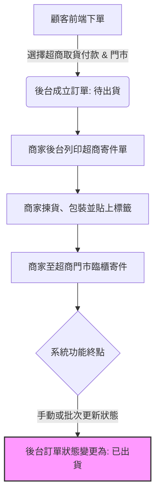

# 超商取貨付款 (COD) 業務流程圖

本流程圖專為**無對接物流狀態（僅到「已出貨」）**的系統所設計。

## 流程節點說明

1. **顧客下單**：顧客在前端選擇「超商取貨付款」，並選擇指定的超商門市。
2. **成立訂單 (待處理)**：系統後台生成訂單，狀態為「待處理/待出貨」。
3. **商家揀貨與包裝**：商家在後台列印寄件單（如 7-11 交貨便 / 全家店到店寄件單），進行包裝。
4. **商家至超商寄件**：商家前往超商櫃台過刷代收，包裹進入超商物流體系。
5. **後台手動/批次變更為「已出貨」**：由於系統本身無對接即時物流回傳，商家於寄件完成後，需在後台將訂單狀態手動變更為**「已出貨」**。此為本系統功能的終端狀態。

---

## 流程圖 (Mermaid 格式)

---

## 注意事項與營運建議
* **通知機制**：當商家將狀態改為「已出貨」時，建議系統觸發 Email 或 SMS 通知顧客「包裹已寄出」，提醒留意簡訊。
* **後續追蹤**：因系統未對接超商回傳的「已到店」、「已取貨」等狀態，商家如需確認顧客是否取貨，需透過超商寄件收據上的**物流單號**至超商官網手動查詢。
